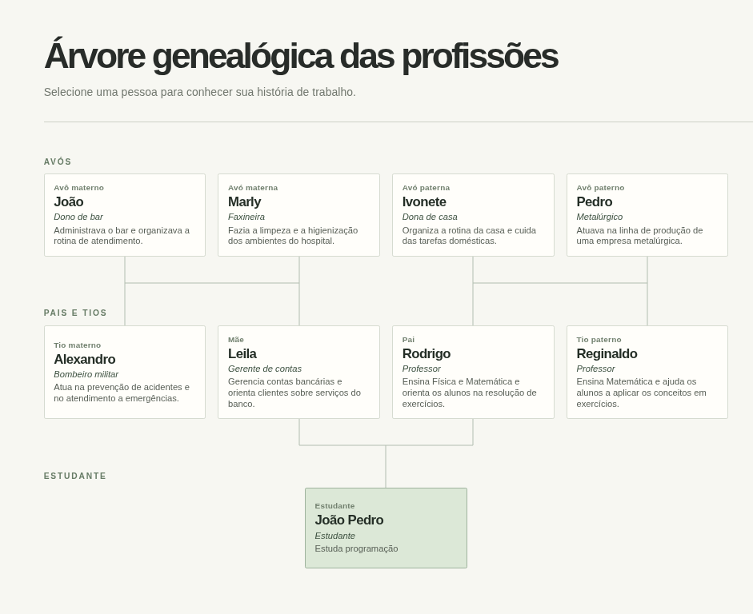

# Árvore genealógica das profissões

Trabalho escolar de **João Pedro** sobre as ocupações de oito familiares e sua trajetória como estudante de programação. A árvore reúne três gerações e mostra o parentesco, a ocupação e uma atividade de cada pessoa.

## Da imagem à pesquisa

Cada cartão da imagem mostra a ocupação e uma atividade da pessoa. Na pesquisa, a ficha correspondente explica **o que faz**, **como a ocupação mudou** e **como a IA pode ser usada**, com as fontes consultadas. Os links seguem a mesma ordem dos cartões, da esquerda para a direita, de cima para baixo.

- [João — Dono de bar](pesquisa.md#joão--dono-de-bar)
- [Marly — Limpeza hospitalar](pesquisa.md#marly--limpeza-hospitalar)
- [Ivonete — Trabalho doméstico](pesquisa.md#ivonete--trabalho-doméstico)
- [Pedro — Metalúrgico](pesquisa.md#pedro--metalúrgico)
- [Alexandro — Bombeiro militar](pesquisa.md#alexandro--bombeiro-militar)
- [Leila — Gerente de contas](pesquisa.md#leila--gerente-de-contas)
- [Rodrigo — Professor de Física e Matemática](pesquisa.md#rodrigo--professor-de-física-e-matemática)
- [Reginaldo — Professor de Matemática](pesquisa.md#reginaldo--professor-de-matemática)
- [João Pedro — Estudante de programação](pesquisa.md#joão-pedro--estudante-de-programação)

## Arquivos da atividade

| Arquivo | Conteúdo |
| --- | --- |
| [arvore-genealogica.png](arvore-genealogica.png) | Imagem da árvore com os nove cartões. |
| [pesquisa.md](pesquisa.md) | O que cada pessoa faz, exemplos de mudanças na ocupação e possíveis usos da inteligência artificial, com fontes. |
| [processo.md](processo.md) | Etapas de montagem, pesquisa e revisão do trabalho. |
